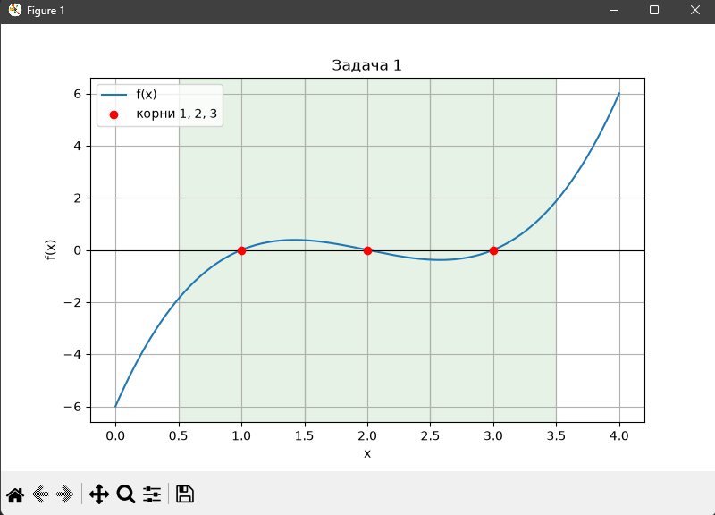
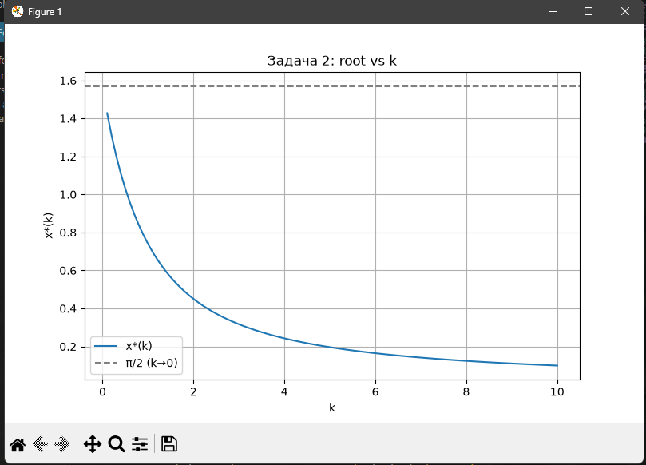
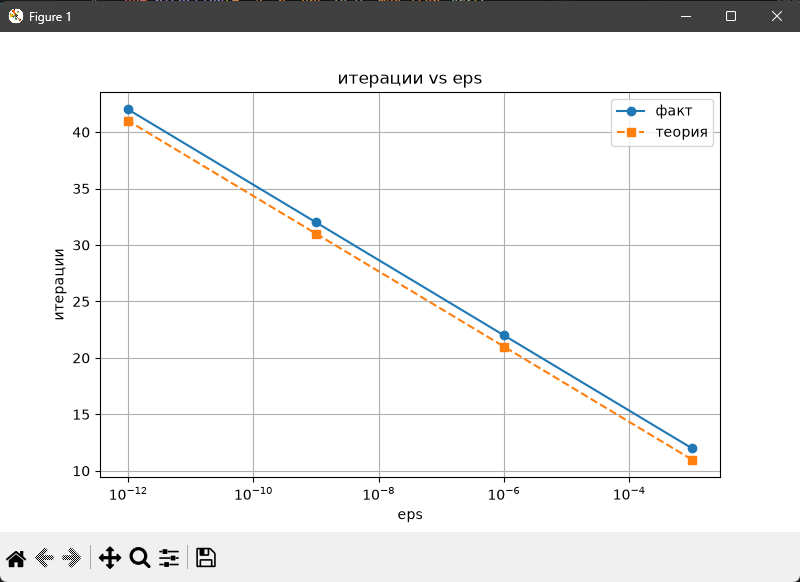

# 9. Задачи на отработку (2 задачи)
## Задача 1. Найти все корни полинома на заданном отрезке
**Условие. Дана функция f(x) = x³ − 6x² + 11x − 6. Известно, что у неё три корня: x = 1, 2, 3.**
1. Постройте график f(x) на отрезке [0, 4] и визуально определите интервалы, содержащие каждый корень.
2. Для каждого интервала примените 
3. Выведите журнал для каждого корня (три таблицы). bisection с точностью ε = 10−9.
4. Сравните число итераций для трёх корней. Объясните, почему они могут отличаться (подсказка: длина стартового интервала).
5. Найдите корни аналитически (разложите полином на множители) и сравните с численным результатом. Оцените абсолютную и относительную погрешность.
Что сдать: скрипт, три журнала, график, таблица «корень → число итераций → Δ →
δ», и вывод о том, совпадает ли число итераций с теоретической оценкой log2(Δ0 / ε)

---

### Решение 1 задачи:
```python
import math
import matplotlib.pyplot as plt

def bisection(f, a, b, eps=1e-9, max_iter=200):
    fa, fb = f(a), f(b)
    if fa * fb > 0:
        raise ValueError(f"Нет смены знака на [{a}, {b}]")
    journal = []
    for k in range(1, max_iter + 1):
        c = (a + b) / 2
        fc = f(c)
        journal.append((k, a, b, c, fc, b - a))
        if fc == 0:
            return c, journal, "f_zero"
        if b - a < eps:
            return c, journal, "ok"
        if fa * fc < 0:
            b = c
        else:
            a = c
            fa = fc
    return c, journal, "max_iter"

print("Задача 1: f(x) = x^3 - 6x^2 + 11x - 6, корни 1, 2, 3\n")

def f1(x):
    return x**3 - 6*x**2 + 11*x - 6

for x in [0, 0.5, 1, 1.5, 2, 2.5, 3, 3.5, 4]:
    print(f"  x={x:>4}  f(x)={f1(x):>10.4f}")

for idx, (a, b) in enumerate([(0.5, 1.5), (1.5, 2.5), (2.5, 3.5)], 1):
    root, journal, status = bisection(f1, a, b, eps=1e-9)
    print(f"\n  Корень {idx} на [{a}, {b}]: root={root:.12f}, "
          f"статус={status}, итераций={len(journal)}")

print("\n  Аналитика: f(x) = (x-1)(x-2)(x-3) -> корни 1, 2, 3")

print("\n  Несимметричные интервалы:")
for (a, b) in [(0, 1.5), (1.5, 2.5), (2.5, 4)]:
    root, journal, status = bisection(f1, a, b, eps=1e-9)
    n_theory = math.ceil(math.log2((b - a) / 1e-9))
    print(f"    [{a}, {b}]: итераций={len(journal)}, теория={n_theory}, корень={root:.9f}")

xs = [i * 0.02 for i in range(201)]
plt.figure(figsize=(8, 5))
plt.plot(xs, [f1(x) for x in xs], label="f(x)")
plt.axhline(0, color="black", linewidth=0.8)
for (a, b) in [(0.5, 1.5), (1.5, 2.5), (2.5, 3.5)]:
    plt.axvspan(a, b, alpha=0.1, color="green")
plt.scatter([1, 2, 3], [0, 0, 0], color="red", zorder=5, label="корни 1, 2, 3")
plt.xlabel("x"); plt.ylabel("f(x)"); plt.title("Задача 1")
plt.legend(); plt.grid(True)
plt.savefig("task1_plot.png", dpi=100)
plt.show()
```

**Вывод консоли:**
```python
Задача 1: f(x) = x^3 - 6x^2 + 11x - 6, корни 1, 2, 3

  x=   0  f(x)=   -6.0000
  x= 0.5  f(x)=   -1.8750
  x=   1  f(x)=    0.0000
  x= 1.5  f(x)=    0.3750
  x=   2  f(x)=    0.0000
  x= 2.5  f(x)=   -0.3750
  x=   3  f(x)=    0.0000 
  x= 3.5  f(x)=    1.8750
  x=   4  f(x)=    6.0000

  Корень 1 на [0.5, 1.5]: root=1.000000000000, статус=f_zero, итераций=1

  Корень 2 на [1.5, 2.5]: root=2.000000000000, статус=f_zero, итераций=1

  Корень 3 на [2.5, 3.5]: root=3.000000000000, статус=f_zero, итераций=1

  Аналитика: f(x) = (x-1)(x-2)(x-3) -> корни 1, 2, 3

  Несимметричные интервалы:
    [0, 1.5]: итераций=32, теория=31, корень=1.000000000
    [1.5, 2.5]: итераций=1, теория=30, корень=2.000000000
    [2.5, 4]: итераций=32, теория=31, корень=3.000000000
```


---

## Задача 2. Бисекция для уравнения с параметром
**Условие. Рассмотрите уравнение f(x) = cos x − kx = 0, где k > 0 — параметр. Это уравнение возникает в задачах о равновесии маятника с трением.**
1. Для k = 0.5 локализуйте корень на отрезке [0, 2] (проверьте смену знака).
Примените бисекцию с ε = 10−9, выведите журнал.
2. Для k = 1, 2, 5 повторите процедуру. Постройте таблицу: k → корень → число
итераций → |f(корень)|.
3. Постройте график зависимости корня от k (для k от 0.1 до 10 с шагом 0.1). Как
ведёт себя корень при k → 0? При k → ∞? Объясните качественно.
4. Для k = 0.5 измените точность ε: 10−3, 10−6, 10−9, 10−12. Постройте таблицу: ε →
число итераций → фактическая ошибка |x − x*|. Сравните с теоретической
оценкой n ≥ log2(Δ0 / ε).
5. Проверьте, что происходит при k = 0: уравнение cos x = 0. Работает ли бисекция
на [0, 2]? Почему? Что нужно изменить?
Что сдать: скрипт, журнал для k = 0.5, таблицы, график «корень vs k», график
«итерации vs ε», и вывод о том, как точность и параметр влияют на число итераций

---
### Решение 2 задачи:
```python
print("\n\nЗадача 2: f(x) = cos(x) - k*x = 0\n")

def f2(x, k):
    return math.cos(x) - k * x

root, journal, status = bisection(lambda x: f2(x, 0.5), 0, 2, eps=1e-9)
print(f"  k=0.5: root={root:.12f}, статус={status}, итераций={len(journal)}")
print(f"  f(0)={f2(0, 0.5):.6f}, f(2)={f2(2, 0.5):.6f} -> смена знака есть")

print("\n  Таблица по k:")
for k in [0.5, 1, 2, 5]:
    r, j, s = bisection(lambda x, kk=k: f2(x, kk), 0, 2, eps=1e-9)
    print(f"    k={k:>4}: root={r:.12f}, итераций={len(j)}, |f|={abs(f2(r, k)):.2e}")

ks = [0.1 * i for i in range(1, 101)]
roots_k = []
for k in ks:
    r, _, _ = bisection(lambda x, kk=k: f2(x, kk), 0, 2, eps=1e-9)
    roots_k.append(r)

plt.figure(figsize=(8, 5))
plt.plot(ks, roots_k, label="x*(k)")
plt.axhline(math.pi / 2, color="gray", linestyle="--", label="π/2 (k→0)")
plt.xlabel("k"); plt.ylabel("x*(k)"); plt.title("Задача 2: root vs k")
plt.legend(); plt.grid(True)
plt.savefig("task2_root_vs_k.png", dpi=100)
plt.show()
print(f"\n  x*(0.1)={roots_k[0]:.6f}, x*(1)={roots_k[9]:.6f}, x*(10)={roots_k[-1]:.6f}")
print("  k -> 0: x*->пи/2;  k -> бесконечность : x* -> 0 (~1/k)")

ref, _, _ = bisection(lambda x: f2(x, 0.5), 0, 2, eps=1e-15)
print(f"\n  Влияние eps (эталон={ref:.15f}):")
iters_eps = []
for eps in [1e-3, 1e-6, 1e-9, 1e-12]:
    r, j, s = bisection(lambda x: f2(x, 0.5), 0, 2, eps=eps)
    iters_eps.append(len(j))
    print(f"    eps={eps:.0e}: итераций={len(j)}, |x-x*|={abs(r - ref):.2e}, "
          f"теория={math.ceil(math.log2(2.0 / eps))}")

plt.figure(figsize=(8, 5))
plt.semilogx([1e-3, 1e-6, 1e-9, 1e-12], iters_eps, "o-", label="факт")
plt.semilogx([1e-3, 1e-6, 1e-9, 1e-12],
             [math.ceil(math.log2(2.0 / e)) for e in [1e-3, 1e-6, 1e-9, 1e-12]],
             "s--", label="теория")
plt.xlabel("eps"); plt.ylabel("итерации"); plt.title("итерации vs eps")
plt.legend(); plt.grid(True)
plt.savefig("task2_iters_vs_eps.png", dpi=100)
plt.show()

r0, j0, s0 = bisection(math.cos, 0, 2, eps=1e-9)
print(f"\n  k=0: root={r0:.12f}, статус={s0}, итераций={len(j0)}")
print(f"пи/2={math.pi/2:.12f}, |разница|={abs(r0 - math.pi/2):.2e}")
print("Бисекция работает на [0,2], но у cos(x)=0 бесконечно много корней ")
print("для поиска всех нужна локализация на подинтервалах")
```
**Вывод консоли:**
```python
Задача 2: f(x) = cos(x) - k*x = 0

  k=0.5: root=1.029866529163, статус=ok, итераций=32
  f(0)=1.000000, f(2)=-1.416147 -> смена знака есть

  Таблица по k:
    k= 0.5: root=1.029866529163, итераций=32, |f|=2.16e-10
    k=   1: root=0.739085133653, итераций=32, |f|=7.33e-10
    k=   2: root=0.450183610898, итераций=32, |f|=9.68e-10
    k=   5: root=0.196164281573, итераций=32, |f|=2.00e-09

  x*(0.1)=1.427552, x*(1)=0.739085, x*(10)=0.099505
  k -> 0: x*->пи/2;  k -> бесконечность : x* -> 0 (~1/k)

  Влияние eps (эталон=1.029866529322259):
    eps=1e-03: итераций=12, |x-x*|=8.14e-05, теория=11
    eps=1e-06: итераций=22, |x-x*|=1.66e-07, теория=21
    eps=1e-09: итераций=32, |x-x*|=1.59e-10, теория=31
    eps=1e-12: итераций=42, |x-x*|=3.31e-13, теория=41

  k=0: root=1.570796327200, статус=ok, итераций=32
пи/2=1.570796326795, |разница|=4.05e-10
Бисекция работает на [0,2], но у cos(x)=0 бесконечно много корней 
для поиска всех нужна локализация на подинтервалах
```


