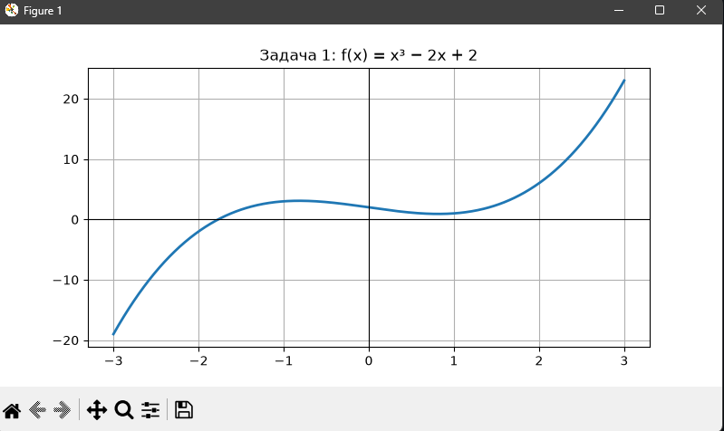

# 7. Задачи на отработку (2 задачи)
## Задача 1. Сравнить методы на функции с плохим стартом
**Условие. Дана функция f(x) = x³ − 2x + 2. У неё один действительный корень (около −1.769).**
1. Постройте график на [−3, 3]. Убедитесь, что корень один.
2. Запустите метод Ньютона с x0 = 0. Что происходит? Почему метод не сходится?
(Подсказка: постройте журнал и посмотрите на f′(xk).)
3. Запустите метод Ньютона с x0 = −2. Сколько итераций?
4. Запустите метод секущих с x0 = −2, x1 = −1. Сколько итераций?
5. Запустите бисекцию на [−2, −1]. Сколько итераций?
6. Постройте таблицу: метод → старт → корень → итераций. Объясните, почему
метод Ньютона с x0 = 0 «застревает».
Что сдать: скрипт, график, журналы, таблица, вывод о том, как выбор начального
приближения влияет на сходимость

---

### Решение 1 задачи:
```python
import math
import matplotlib.pyplot as plt

def newton(f, df, x0, eps=1e-12, n=100):
    x = x0
    for k in range(1, n+1):
        fx, dfx = f(x), df(x)
        if dfx == 0:
            return x, k, "zero_deriv"
        xn = x - fx/dfx
        if abs(xn-x) < eps or abs(fx) < eps:
            return xn, k, "ok"
        x = xn
    return x, n, "max_iter"

def secant(f, x0, x1, eps=1e-12, n=100):
    for k in range(1, n+1):
        f0, f1 = f(x0), f(x1)
        if f1 - f0 == 0:
            return x1, k, "zero_denom"
        xn = x1 - f1*(x1-x0)/(f1-f0)
        if abs(xn-x1) < eps or abs(f1) < eps:
            return xn, k, "ok"
        x0, x1 = x1, xn
    return x1, n, "max_iter"

def bisect(f, a, b, eps=1e-12, n=200):
    fa = f(a)
    for k in range(1, n+1):
        c = (a+b)/2
        fc = f(c)
        if fc == 0 or (b-a) < eps:
            return c, k
        if fa*fc < 0:
            b = c
        else:
            a, fa = c, fc
    return c, n

f1  = lambda x: x**3 - 2*x + 2
df1 = lambda x: 3*x**2 - 2

xs = [i/100 for i in range(-300, 301)]
plt.plot(xs, [f1(x) for x in xs])
plt.axhline(0, color='k', lw=0.8)
plt.title("f(x) = x^3 - 2x + 2")
plt.grid(True); plt.savefig("t1.png"); plt.close()

print("Задача 1")
print("Ньютон x0=0 :", newton(f1, df1, 0.0, n=10))
print("Ньютон x0=-2:", newton(f1, df1, -2.0))
print("Секущие     :", secant(f1, -2.0, -1.0))
print("Бисекция    :", bisect(f1, -2.0, -1.0))

fk  = lambda x, k: math.exp(x) - k*x
dfk = lambda x, k: math.exp(x) - k
```

**Вывод консоли:**
```python
адача 1
Ньютон x0=0 : (0.0, 10, 'max_iter')
Ньютон x0=-2: (-1.7692923542386314, 5, 'ok')
Секущие     : (-1.7692923542386314, 9, 'ok')
Бисекция    : (-1.769292354238587, 41)
```


---

## Задача 2. Уравнение с параметром: ex − kx = 0
**Условие. Рассмотрите уравнение f(x) = ex − kx = 0, где k > 0 — параметр.**
1. Для k = 1 уравнение не имеет действительных корней (проверьте: минимум f(x)
равен 1 − ln 1 = 1 > 0).
2. Для k = e уравнение имеет один корень x = 1 (касание). Проверьте: f(1) = e − e · 1
= 0, f′(1) = e − e = 0. Метод Ньютона здесь не работает (деление на ноль). Метод
секущих — тоже (знаменатель → 0). Бисекция — не работает (нет смены знака).
Объясните, почему.
3. Для k = 3 уравнение имеет два корня. Найдите их методами Ньютона, секущих и
бисекции. Постройте таблицу: метод → корень → итераций.
4. Для k = 5 повторите. Сравните число итераций.
5. Постройте график зависимости корней от k (для k от e до 10 с шагом 0.1). Как
ведут себя корни при k → e+? При k → ∞?
Что сдать: скрипт, таблицы, графики, вывод о том, как параметр влияет на число
корней и на сходимость методов!

---

### Решение 2 задачи:
```python
print("\nЗадача 2")
print("k=1  : min f = 1 > 0, корней нет")

print("k=e  : корень x=1 (f'(1)=0 — Ньютон/секущие ломаются)")
f_e  = lambda x: fk(x, math.e)
df_e = lambda x: dfk(x, math.e)
print("  Ньютон :", newton(f_e, df_e, 0.9))
print("  Секущие:", secant(f_e, 0.9, 1.1))

for k in (3.0, 5.0):
    f  = lambda x: fk(x, k)
    df = lambda x: dfk(x, k)
    print(f"\nk={k}:")
    for name, fn in [("Ньютон",  lambda a: newton(f, df, a)),
                     ("Секущие", lambda a: secant(f, a, a+0.5)),
                     ("Бисекция",lambda a: bisect(f, a, a+1.0))]:
        r1 = fn(0.1)
        r2 = fn(1.5)
        print(f"  {name:<9} малый={r1[0]:.10f} ({r1[1]} ит), "
              f"большой={r2[0]:.10f} ({r2[1]} ит)")

ks, small, large = [], [], []
k = math.e
while k <= 10:
    ks.append(k)
    try: small.append(bisect(lambda x: fk(x,k), 0.0, 1.5)[0])
    except: small.append(float('nan'))
    try: large.append(bisect(lambda x: fk(x,k), 1.5, 5.0)[0])
    except: large.append(float('nan'))
    k += 0.1

plt.figure(figsize=(8, 4))
plt.plot(ks, small, 'o-', ms=3, label="малый корень")
plt.plot(ks, large, 's-', ms=3, label="большой корень")
plt.axvline(math.e, color='r', ls='--', label='k = e (касание)')
plt.xlabel('k'); plt.ylabel('x'); plt.legend(); plt.grid(True)
plt.title("Задача 2: корни eˣ − kx = 0 от k")
plt.savefig("t2.png")

plt.show()
```
**Вывод консоли:**
```python
Задача 2
k=1  : min f = 1 > 0, корней нет
k=e  : корень x=1 (f'(1)=0 — Ньютон/секущие ломаются)
  Ньютон : (0.9999996309548452, 18, 'ok')
  Секущие: (1.000000370465834, 29, 'ok')

k=3.0:
  Ньютон    малый=0.6190612867 (6 ит), большой=1.5121345517 (4 ит)
  Секущие   малый=0.6190612867 (6 ит), большой=1.5121345517 (7 ит)
  Бисекция  малый=0.6190612867 (41 ит), большой=1.5121345517 (41 ит)

k=5.0:
  Ньютон    малый=0.2591711018 (5 ит), большой=0.2591711018 (7 ит)
  Секущие   малый=0.2591711018 (6 ит), большой=2.5426413578 (12 ит)
  Бисекция  малый=0.2591711018 (41 ит), большой=2.5000000000 (41 ит)
```
[График к 2ой задачи](screens/nm_cl_25_11_part2_2.png)
